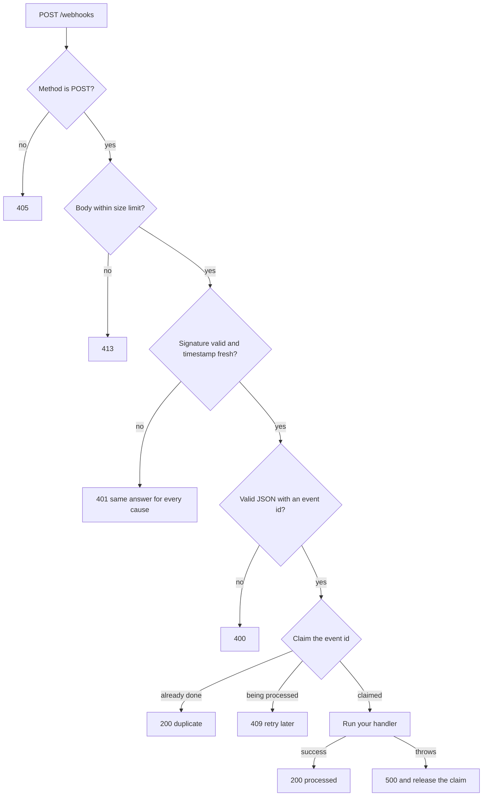

# webhook-verifier


Safe webhook handling for systems that move money: timing-safe signature checks, replay protection, secret rotation and idempotent processing, in TypeScript with no runtime dependencies.

A payment provider will send you the same event twice. An attacker will send you events that look real. Both end the same way if your handler is naive: a wallet credited twice, or credited for money that never arrived. This repo shows how to design those failures out.

By [Damilola Craig](https://dammycraig.ihub.website). A companion to [ledger-schema](https://github.com/dammydcraig/ledger-schema), which handles the other half: posting the credit safely once the event is trusted.

## What it protects against

| Threat | Defence |
| --- | --- |
| Forged event | HMAC-SHA256 over the exact raw bytes, compared in constant time |
| Tampered amount | Any change to the body breaks the signature |
| Replay of a captured request | The timestamp is part of the signed string, and requests outside a tolerance window (default 5 minutes) are rejected |
| Provider retries and double delivery | Each event id is claimed before processing, so retries are acknowledged without running your code again |
| Two copies arriving at the same moment | Only one claim succeeds; the other gets `409` with `Retry-After` |
| Your handler crashes mid-way | The claim is released, so the provider's retry can succeed |
| Secret rotation | Several secrets accepted at once, so rotation needs no downtime |
| Missing or empty secret in the environment | Fails closed with a `500`. An empty key still produces a valid HMAC, so it must never be allowed to verify anything |
| Oversized bodies | Capped at 1 MB by default |
| Probing the verifier | Every rejection looks the same to the sender; the real reason goes to your logs |

## Quick start

Requires Node 22 or later.

```bash
git clone https://github.com/dammydcraig/webhook-verifier.git
cd webhook-verifier
npm install
npm test
```

Receive webhooks:

```ts
import { createServer } from "node:http";
import { createWebhookHandler, timestampedVerifier } from "./src/index.js";

const handler = createWebhookHandler({
  verify: timestampedVerifier({ secrets: [process.env.WEBHOOK_SECRET!] }),
  onEvent: async ({ id, type, payload }) => {
    // Your business logic. Throw to ask the provider to retry.
  },
});

createServer((req, res) => (req.url === "/webhooks" ? handler(req, res) : res.writeHead(404).end())).listen(3000);
```

Send webhooks (for tests, or if you are the provider):

```ts
import { signPayload } from "./src/index.js";

const body = JSON.stringify({ id: "evt_1001", type: "payment.succeeded", data: { amount: 500000 } });
const { header } = signPayload({ secret: "demo_secret", body });
// POST `body` with the header  x-webhook-signature: <header>   ->   t=1760000000,v1=9f2c...
```

Verify without the HTTP layer, for any framework:

```ts
import { verifySignature } from "./src/index.js";

verifySignature(rawBody, request.headers["x-webhook-signature"], { secrets: [newSecret, oldSecret] });
// throws WebhookVerificationError, with a stable `code`, on any failure
```

## See it work

```bash
# terminal 1
WEBHOOK_SECRET=demo_secret npm run example:server

# terminal 2
WEBHOOK_SECRET=demo_secret npm run example:send
```

```text
1. genuine delivery                          -> 200 {"status":"processed"}
2. provider retries the same event           -> 200 {"status":"duplicate"}
3. attacker changes the amount               -> 401 {"error":"invalid_signature"}
4. attacker signs with a guessed secret      -> 401 {"error":"invalid_signature"}
5. replay of a captured request, 1 hour old  -> 401 {"error":"invalid_signature"}
6. no signature header at all                -> 401 {"error":"invalid_signature"}
```

The server's own log shows what the sender is never told:

```text
{"level":"info","message":"wallet credited","id":"evt_1001","account":"acct_001","balance":500000}
{"level":"info","message":"webhook processed","id":"evt_1001","type":"payment.succeeded"}
{"level":"info","message":"duplicate webhook ignored","id":"evt_1001","type":"payment.succeeded"}
{"level":"warn","message":"webhook rejected","code":"signature_mismatch"}
{"level":"warn","message":"webhook rejected","code":"signature_mismatch"}
{"level":"warn","message":"webhook rejected","code":"timestamp_outside_tolerance"}
{"level":"warn","message":"webhook rejected","code":"missing_signature"}
```

The wallet was credited once: ₦5,000.00 (500,000 kobo), not twice.

## How it works

The sender signs `"<timestamp>.<raw body>"` with HMAC-SHA256 and sends `x-webhook-signature: t=<timestamp>,v1=<hex>`. Putting the timestamp inside the signed string is what makes replay protection possible: an attacker cannot refresh an old request's timestamp without invalidating its signature.



Status codes are chosen for how providers retry: `2xx` stops retries, `409` and `5xx` ask for another attempt, and `400` and `401` are not worth retrying because they will not change.

## Design decisions

- **Verify the raw bytes.** Parsing the JSON and serializing it again changes whitespace and key order, which breaks the signature. The handler verifies the bytes as received and parses only afterwards.
- **Signature first, then timestamp.** A caller who cannot sign only ever learns "signature mismatch", so the clock window cannot be probed.
- **Claim after verifying, not before.** A forged copy of an event must not be able to use up the event id and block the genuine delivery. There is a test for exactly this.
- **Compare in constant time, with no early exit,** across every configured secret and every signature in the header, so timing reveals neither which secret nor which signature matched.
- **Fail closed.** No secret, an empty secret or a nonsensical tolerance raises an error. It never degrades into "verify nothing".
- **Acknowledge permanently bad events.** A signed event your code cannot make sense of will never succeed on retry. The example server logs and acknowledges it, instead of throwing and inviting endless redelivery.

## Paystack

`verifyPaystackSignature` and `paystackVerifier` support Paystack's scheme: HMAC-SHA512 of the raw body with your secret key, hex-encoded, in `x-paystack-signature`. I checked this against third-party guides; **confirm it against Paystack's current documentation before relying on it in production.** Paystack payloads carry no top-level event id, so `paystackEventParser` identifies an event by its name plus the object's `id` (or `reference`).

This scheme has no timestamp, so a captured, validly signed request can be replayed. Idempotent processing covers it only as long as the event id is remembered. For important events, confirm with the provider's API (for example, verify the transaction) before acting.

## What the tests prove

58 tests run on Node 22, covering every row of the threat table above: tampering, wrong secrets, malformed and missing headers, the exact edges of the replay window, rotation, fail-closed behavior, raw-byte verification, concurrent duplicates, failure and retry, oversized and streamed bodies, and the forged-copy case. HTTP behavior is tested against a real server on a real port.

I also broke the code on purpose in 11 ways (skipping the signature check, skipping the replay window, signing without the timestamp, allowing empty secrets, checking only the first secret, not releasing claims on failure, verifying re-serialized JSON, leaking the failure reason, removing the size limit, and others) and confirmed the suite fails each time.

**Not tested:** that the comparison is actually constant-time. Timing cannot be asserted reliably in a unit test. It relies on `crypto.timingSafeEqual`, and that is a design property you should review in the source, not a tested one.

## Limits

This is a reference implementation for study and demonstration. It has not been security audited.

- **The in-memory store is per-process.** It forgets everything on restart and does not coordinate between instances. In production, use a shared store with an atomic "insert if absent": a database unique constraint, or Redis `SET NX` with an expiry. The `IdempotencyStore` interface is three small methods.
- **Delivery is at-least-once, not exactly-once.** If your process crashes after your code has done its work but before the event is marked complete, the retry runs it again. So the side effect itself must be idempotent too. For money, pass the event id to your ledger as its idempotency key, as [ledger-schema](https://github.com/dammydcraig/ledger-schema) does.
- **Clocks matter.** The replay window assumes the sender's and receiver's clocks agree within the tolerance.
- **Out of scope:** TLS termination, rate limiting, IP allowlisting, and any provider-specific schemes beyond the two included.

## Project layout

```text
src/signature.ts    timestamped HMAC scheme: sign, parse, verify
src/paystack.ts     Paystack scheme (HMAC-SHA512 over the raw body)
src/idempotency.ts  claim/complete/release store and processOnce()
src/handler.ts      Node http handler, status codes, event parsers
examples/           runnable server and a simulated provider
test/               58 tests
```

## Roadmap

- A Postgres or Redis store implementing `IdempotencyStore`
- A Flutterwave scheme
- Express and Fastify adapters
- A Dockerfile with a reverse proxy and TLS

## License

MIT. See [LICENSE](LICENSE).
